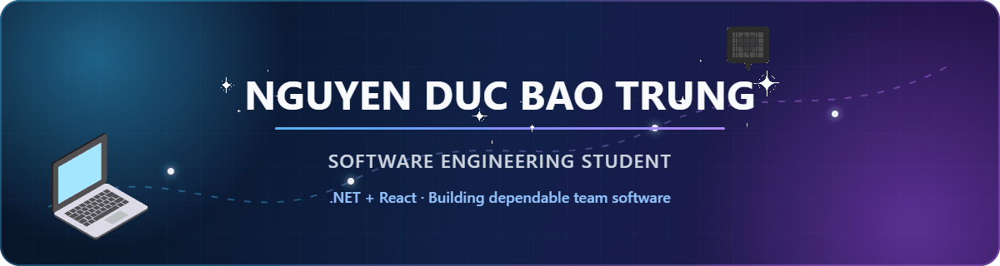

  

   

  
  
  

## About me

I am a second-year **Software Engineering student at UIT, VNU-HCM**, with a current GPA of **8.47/10**. I build full-stack and desktop applications with **C#/.NET, React, TypeScript, and SQL Server**, with an emphasis on clear domain rules, maintainable architecture, and reliable team workflows.

- Building **TeamPulse**, a full-stack collaboration hub for university project teams
- Experienced in leading and coordinating teams of **4–16 members**
- Comfortable moving from requirements and database design to implementation, testing, and delivery
- Preparing for software engineering internship opportunities while continuing to deepen my .NET and React skills

## Tech stack

**Backend & data**

**Frontend**

**Engineering tools**

Also worked with **C++, WPF, WinForms, Firebase, Vercel, Framer Motion, and Linux**.

## Featured projects

### [TeamPulse](https://github.com/Btrung-uit/TeamPulse) · Flagship project

**Student Project & Engineering Collaboration Hub** that connects a team's work through:

`Task → Evidence → Review → Contribution Report → Presentation`

- Built a modular-monolith application with **ASP.NET Core, React, TypeScript, SQL Server, and EF Core**
- Implemented workspace-scoped authorization, task and sprint planning, dependency validation, evidence review, dashboards, and Presentation Mode
- Added reviewed, transactional **Excel onboarding and export**, automated tests, GitHub Actions CI, and a production-like Docker Compose workflow
- Combined product direction, architecture, implementation, and delivery decisions into one coherent engineering workflow

### [Hotel & Booking Management System](https://github.com/Btrung-uit/HotelBookingManagerment) · Team lead · In progress

A **C# WinForms and SQL Server** desktop application for the hotel lifecycle from reservation and check-in through checkout, payment, and room turnover.

- Organizing the project around a layered architecture with clear presentation, business, data-access, and domain boundaries
- Leading foundation work, authentication, integration, pull-request review, and release coordination

### [MIDAS Interactive Learning Website](https://github.com/Btrung-uit/KTCT-web-project) · [Live demo](https://ktct-nhom-1-web-project.vercel.app)

A responsive learning experience built in six days by a 16-member team using **React, TypeScript, Tailwind CSS, Firebase, and Vercel**.

- Turned course content into a 13-page interactive ebook and a 20-question quiz
- Used Firebase for real-time leaderboard data and coordinated a fast, parallel team delivery

## GitHub activity

  

## Let's connect

I enjoy building software that turns real workflows into clear, dependable systems. If you would like to discuss an internship, a student project, or a collaboration, feel free to reach out through [LinkedIn](https://www.linkedin.com/in/baotrung2k7) or [email](mailto:baotrung2k7@gmail.com).
